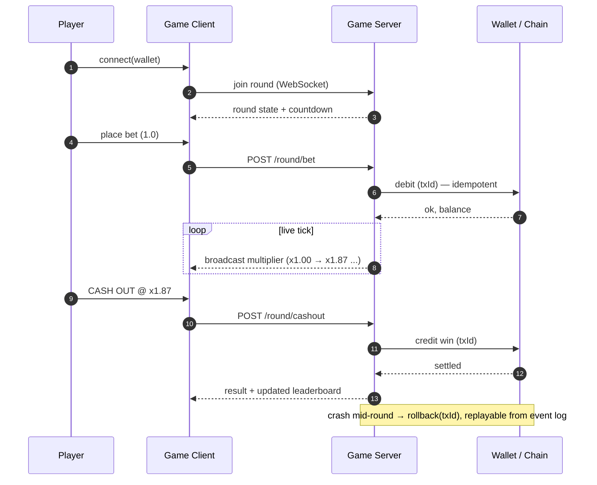

<div align="center">


<a href="https://github.com/tramslegend">
  
</a>

<br/>


</div>

---

## `>` whoami

```ts
const dev: FullStackEngineer = {
  role:       "Full-stack TypeScript Developer",
  focus:      ["Next.js App Router", "Real-time systems", "Web3 / Solana"],
  frontend:   ["React", "TypeScript", "Tailwind CSS", "shadcn/ui"],
  backend:    ["Node.js", "PostgreSQL", "MongoDB", "Redis", "Zod"],
  realtime:   ["WebSockets", "Pusher", "live rounds & leaderboards"],
  web3:       ["Solana web3.js", "wallet integration", "on-chain settlement"],
  currently:  "real-time multiplayer games with wallets & live state",
  philosophy: "Ship production systems, not demos.",
};
```

I build fast, production-ready web apps — from the database schema all the way to the pixel.
**Real-time multiplayer games** on Solana, and **full e-commerce platforms** with payments, auth,
email and admin tooling. Not prototypes — systems that handle real users, real money, and real traffic.

---

## `>` what I build

<table>
<tr>
<td width="33%" valign="top">

### 🎮 Real-time Games

Live multiplayer rounds<br/>
WebSocket state sync<br/>
Wallet integration (Solana)<br/>
Live leaderboards<br/>
Round history & replay<br/>
Provably-fair outcomes<br/>
Low-latency broadcast

</td>
<td width="33%" valign="top">

### 🛒 E-commerce

Product catalog & search<br/>
Stripe checkout & webhooks<br/>
Auth & sessions<br/>
Transactional email<br/>
Image / file uploads<br/>
Admin & order tooling<br/>
Inventory management

</td>
<td width="33%" valign="top">

### 🔌 Full-stack & Infra

Next.js App Router<br/>
API routes & server actions<br/>
PostgreSQL / Mongo / Redis<br/>
Caching & rate limiting<br/>
Docker & Vercel deploys<br/>
Type-safe end to end (Zod)<br/>
Testing with Vitest

</td>
</tr>
</table>

---

## `>` the stack

<div align="center">

**Frontend**


**Backend / Real-time**


**Data &amp; Infra**


**Payments / Web3**


</div>

---

## `>` real-time game round

How a live multiplayer round flows — bet, live state, cash-out, settle:



---

## `>` provably-fair outcome

```ts
import { createHmac, createHash } from "node:crypto";

/**
 * Deterministic round outcome from a committed server seed.
 * Players verify after the round: sha256(serverSeed) === publishedHash
 */
export function roundOutcome(
  serverSeed: string,
  clientSeed: string,
  nonce: number,
): number {
  const digest = createHmac("sha256", serverSeed)
    .update(`${clientSeed}:${nonce}`)
    .digest();

  // unbiased sampling — never a naive `% n` (modulo bias skews fairness)
  const n = digest.readUInt32BE(0) / 0xffffffff;
  return Math.max(1, Math.floor((1 / (1 - n)) * 100) / 100); // crash multiplier
}

export const commit = (serverSeed: string) =>
  createHash("sha256").update(serverSeed).digest("hex");
```

<div align="center">

**`commit` → `play` → `reveal` → `verify`** — every round is auditable.

</div>

---

## `>` featured work

| Project | What it is | Stack |
|---|---|---|
| **RUG-GAME** | Real-time crash-style game on Solana — live rounds, wallet integration, leaderboard | Next.js · Solana · Pusher · Redis · Postgres |
| **Electronics-shop** | Full e-commerce: catalog, Stripe checkout, auth, email, image uploads | Next.js · Stripe · Better Auth · MongoDB |
| **CCTV-SHOP** | Security-equipment storefront on the same commerce platform | Next.js · Stripe · MongoDB · Resend |
| **[Stop-watch](https://github.com/tramslegend/Stop-watch)** | Minimal stopwatch app | Next.js · Tailwind |

<!-- Swap in your real project links / live demos for each row. -->

---

## `>` platform capabilities

<details>
<summary><b>🎮 Real-time Engine</b></summary>

- Authoritative server state with WebSocket broadcast
- Live multiplier / round ticks at low latency
- Reconnect & state resync on drop
- Round history, replay and audit log
- Redis-backed leaderboards (sorted sets)

</details>

<details>
<summary><b>💳 Payments &amp; Commerce</b></summary>

- Stripe checkout, webhooks and refunds
- Idempotent order & payment handling
- Cart, inventory and catalog management
- Transactional email (Resend) for receipts & auth
- Admin dashboard for orders and products

</details>

<details>
<summary><b>🔐 Auth &amp; Security</b></summary>

- Session & credential auth (Better Auth)
- Role-based access for admin tooling
- Input validation end-to-end with Zod
- Rate limiting and request validation
- Secure file/image uploads (Vercel Blob)

</details>

<details>
<summary><b>📊 Data &amp; Tooling</b></summary>

- PostgreSQL, MongoDB and Redis depending on the workload
- Type-safe data access and schemas
- Docker for local parity, Vercel for deploys
- Vitest test coverage on core logic

</details>

---

## `>` engineering principles

```
1. Type-safe end to end — if it compiles, it's closer to correct.
2. Money and game state move through a state machine, never an if-statement.
3. Every write is idempotent — the network will betray you.
4. Real-time means authoritative server, dumb client.
5. Validate at the boundary (Zod), trust nothing from the wire.
6. Ship production systems, not demos.
```

---

## `>` stats

<div align="center">


</div>

---

## `>` let's build

<div align="center">

Open to **freelance** and **full-time** work — real-time apps, Next.js products, or e-commerce builds.

<a href="https://github.com/tramslegend">
  
</a>
<!-- Replace the placeholder hrefs below with your real links, then uncomment:
<a href="mailto:you@example.com"></a>
<a href="https://t.me/your-handle"></a>
<a href="https://linkedin.com/in/your-handle"></a>
-->

<br/><br/>


</div>
