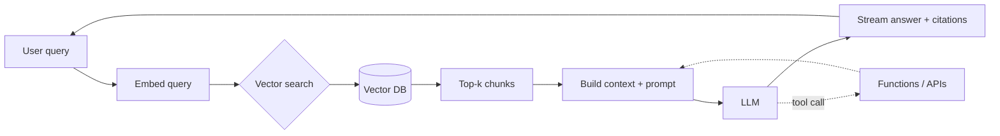

<div align="center">


<a href="https://github.com/tramslegend">
  
</a>

<br/>


</div>

---

## `>` whoami

```python
class AIEngineer:
    background = "Full-stack TypeScript / Next.js engineer"
    now        = "Building AI-powered products & ML systems"
    building   = ["LLM apps", "RAG pipelines", "tool-using agents"]
    studying   = ["transformers from scratch", "autograd", "training loops"]
    stack_ml   = ["Python", "PyTorch", "LLM APIs", "vector DBs"]
    stack_web  = ["Next.js", "TypeScript", "Node.js", "Postgres", "Redis"]
    edge       = "I can take an AI idea from model to a shipped product"
    philosophy = "Understand the fundamentals, then ship real systems."
```

I come from **full-stack product engineering** — shipping real Next.js apps with payments, auth and
real-time systems — and I'm now focused on **AI engineering**: building **LLM-powered applications**
(RAG, agents, tool-use) and learning the ML foundations underneath by **implementing them from scratch**.

My edge: I don't just call a model API — I can wrap it in a real, production-grade product.

---

## `>` what I build

<table>
<tr>
<td width="33%" valign="top">

### 🤖 LLM Applications

RAG over private data<br/>
Tool-using agents<br/>
Structured output / function calls<br/>
Streaming chat UIs<br/>
Prompt & context engineering<br/>
Eval & guardrails<br/>
Cost / latency optimization

</td>
<td width="33%" valign="top">

### 🧠 ML Foundations

Transformers from scratch<br/>
Autograd & backprop<br/>
Training & fine-tuning loops<br/>
Tokenization & embeddings<br/>
Attention mechanics<br/>
Model evaluation<br/>
Scaling intuition

</td>
<td width="33%" valign="top">

### 🔌 Full-stack AI

Next.js + model backends<br/>
Vector DB integration<br/>
Streaming APIs & queues<br/>
Auth, billing & limits<br/>
Caching & rate limiting<br/>
Docker / Vercel deploys<br/>
Type-safe end to end

</td>
</tr>
</table>

---

## `>` the stack

<div align="center">

**AI / ML**


**AI App Layer**


**Full-stack**


</div>

---

## `>` a RAG pipeline

How I wire retrieval-augmented generation into a product:



---

## `>` from first principles

I learn by rebuilding the fundamentals, not just importing them. A micro-autograd in the spirit of backprop:

```python
class Value:
    """A scalar that tracks its gradient — the core idea behind autograd."""
    def __init__(self, data, _children=()):
        self.data, self.grad = data, 0.0
        self._backward = lambda: None
        self._prev = set(_children)

    def __mul__(self, other):
        out = Value(self.data * other.data, (self, other))
        def _backward():
            self.grad  += other.data * out.grad
            other.grad += self.data  * out.grad
        out._backward = _backward
        return out
```

<div align="center">

*Implementing transformers, autograd and training loops by hand — so the APIs aren't magic.*

</div>

---

## `>` currently

```
▸ Building   : my-autograd — a reverse-mode autodiff engine from scratch
▸ Studying   : GPT internals, attention, and training loops from first principles
▸ Next up    : vectorized Tensor engine, Adam optimizer, a small LLM app
```

---

## `>` featured

| Project | What it is | Highlights |
|---|---|---|
| **[my-autograd](https://github.com/tramslegend/my-autograd)** | A tiny reverse-mode autodiff engine + neural net library, pure Python, no frameworks | Implements backprop via topological-sort; trains an MLP from 48% → 96% accuracy |

<sub>The core of every ML framework (PyTorch's <code>loss.backward()</code>) built by hand to understand it end to end.</sub>

<!-- Add more real projects here as you build them. -->

---

## `>` platform capabilities

<details>
<summary><b>🤖 LLM Application Layer</b></summary>

- RAG over private documents with chunking + reranking
- Tool-using agents with structured (function-call) output
- Streaming chat with token-by-token UI
- Prompt / context engineering and templating
- Output validation and guardrails
- Token-cost and latency budgeting

</details>

<details>
<summary><b>🧠 ML Fundamentals (hands-on study)</b></summary>

- Transformer blocks: attention, MLP, residual, layernorm
- Autograd / backprop implemented by hand
- Training loops, optimizers, LR schedules
- Tokenization and embeddings
- Evaluation and overfitting diagnostics

</details>

<details>
<summary><b>🔌 Productionizing AI</b></summary>

- Next.js backends calling model providers
- Vector DB integration (pgvector / Pinecone)
- Streaming APIs, queues and background jobs
- Auth, rate limiting and usage metering
- Docker + Vercel deployment

</details>

---

## `>` engineering principles

```
1. Understand the fundamentals before importing the abstraction.
2. An LLM feature is still a product — auth, limits, errors, UX all matter.
3. Validate model output at the boundary; never trust it blindly.
4. Measure cost and latency like any other production metric.
5. Evals over vibes — know when the model actually got better.
6. Ship real systems, not notebooks.
```

---

## `>` role

<div align="center">


<br/><br/>


</div>

---

## `>` let's build

<div align="center">

Open to **AI engineering** roles and projects — LLM apps, RAG systems, and full-stack AI products.

<a href="https://github.com/tramslegend">
  
</a>
<!-- Add your real links, then uncomment:
<a href="mailto:you@example.com"></a>
<a href="https://linkedin.com/in/your-handle"></a>
-->

<br/><br/>


</div>
